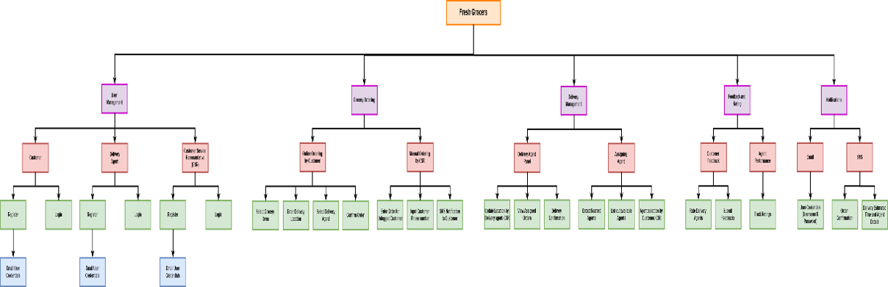
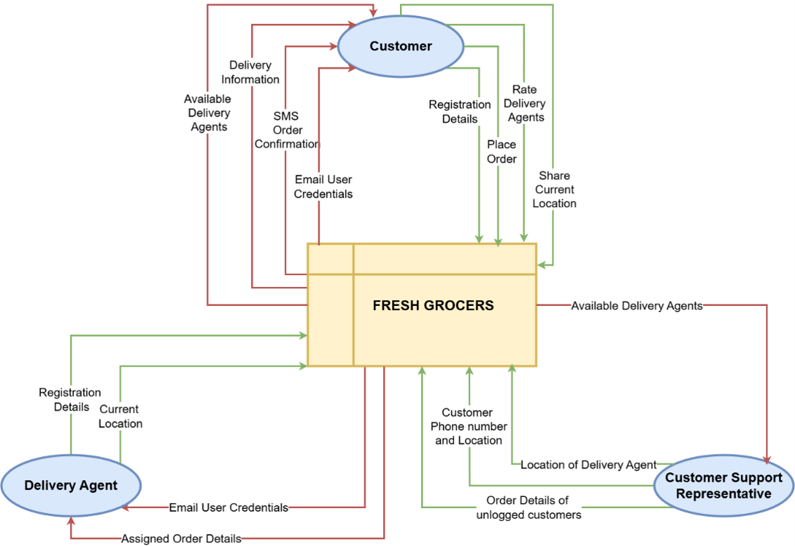
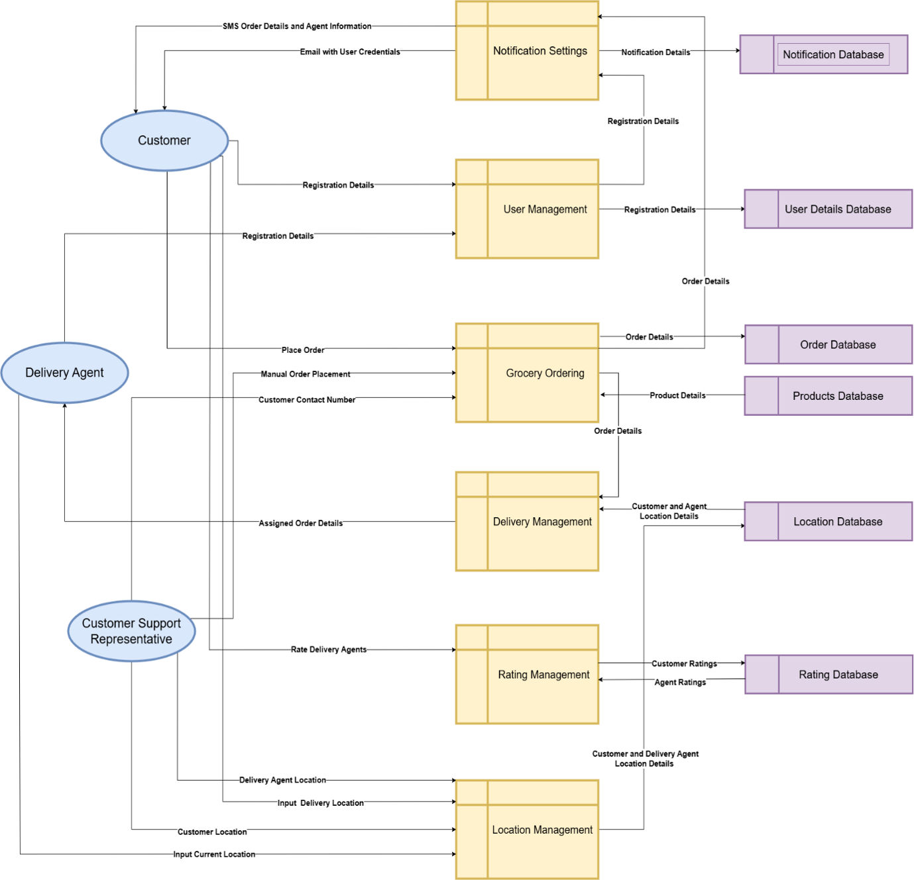
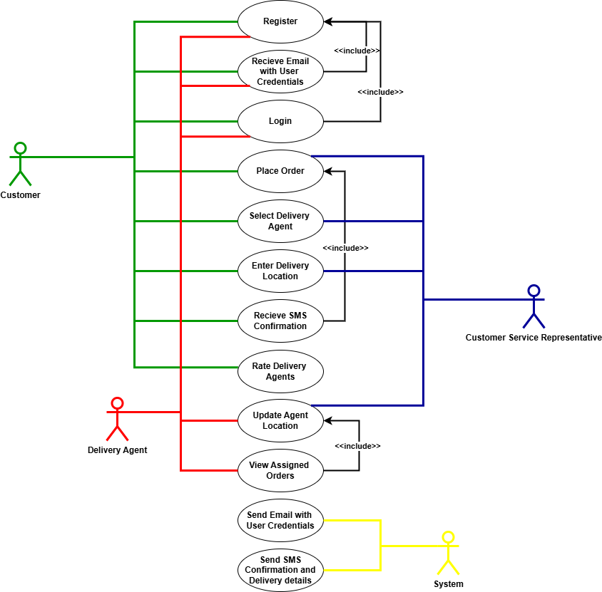
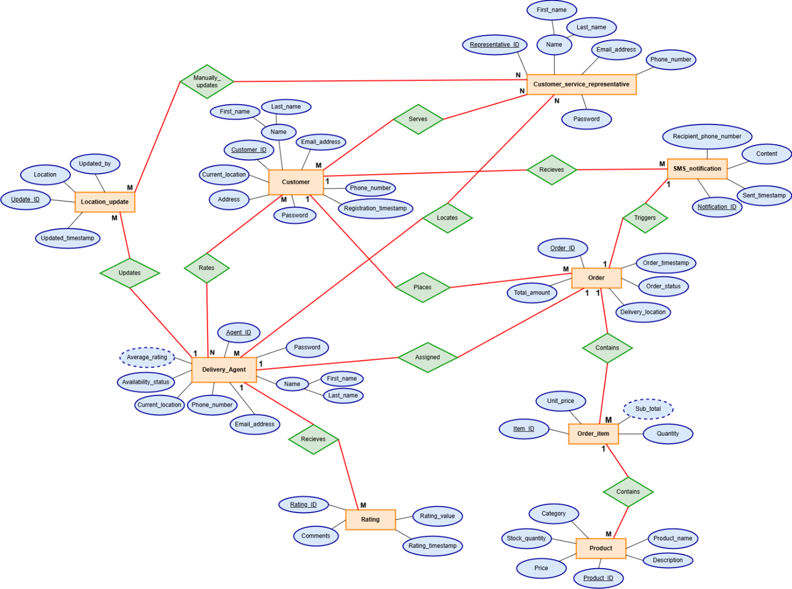
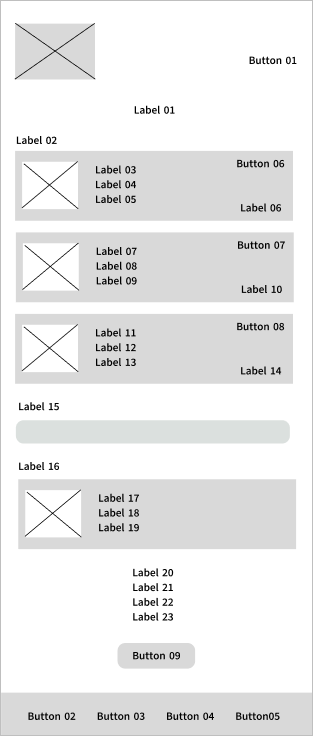
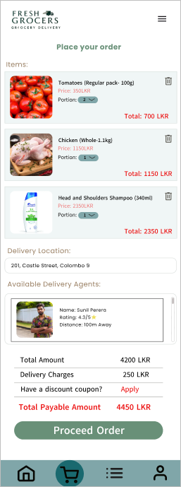

# Fresh Grocers | System Analysis & Design

## Project Overview

This project presents a comprehensive **System Analysis and Design case study** for Fresh Grocers, a grocery delivery service described in an academic scenario set in Sri Lanka.

The study focuses on analysing an existing manual, telephone-based grocery ordering process and proposing a web-based ordering and delivery management system to improve operational efficiency, customer experience, and service coordination.

The project demonstrates practical skills in business analysis, requirements engineering, feasibility assessment, system modelling, Agile methodology evaluation, and user interface design.

**Project Type:** Academic System Analysis & Design Case Study  
**Project Scope:** Requirements Analysis, Feasibility Study, System Design and Documentation  
**Development Status:** Analysis and design completed — no application developed or deployed

---

## Business Problem

Fresh Grocers relies on manual processes for receiving customer orders, assigning delivery agents, and communicating delivery information.

The existing approach presents several challenges:

- Time-consuming telephone-based order processing
- Manual delivery agent assignment
- Limited visibility into available delivery agents and their locations
- Lack of a centralized customer ordering platform
- Manual order confirmations and delivery communication
- Increased risk of administrative errors
- Limited customer feedback and delivery rating capabilities

The proposed solution aims to modernize these processes through a centralized web-based platform.

## Proposed Solution

The study proposes a grocery ordering and delivery management system with the following capabilities:

- Online registration and authentication for customers and delivery agents
- Web-based grocery ordering
- Customer service representative-assisted order placement
- Location-based delivery agent selection
- Manual delivery agent location updates
- Automated SMS order confirmations
- Delivery agent ratings and customer feedback
- Role-specific interfaces for customers, delivery personnel, and customer service representatives

These features are documented as proposed requirements and designs. They were not implemented as working software.

---

## Project Methodology

### 1. SDLC and Methodology Evaluation

Explored the Software Development Life Cycle and compared Traditional Waterfall and Agile methodologies.

Evaluated both approaches against Fresh Grocers' business requirements, recommending Agile as the more suitable approach due to its flexibility, iterative planning, and stakeholder involvement.

### 2. Feasibility Study

Conducted a feasibility assessment covering operational, technical, economic, schedule, and legal feasibility.

The study also examined projected costs and benefits, project risks, mitigation strategies, and alternative technical solutions.

### 3. Requirements Analysis

Identified and documented functional and non-functional requirements for the proposed system.

Considered the needs of customers, delivery agents, customer service representatives, management, and technical stakeholders.

Explored fact-finding techniques including interviews, questionnaires, observation, document analysis, prototyping, and workshops.

### 4. System Modelling and Design

Prepared system design documentation, including:

- System Architecture Diagram
- Level 0 Data Flow Diagram
- Level 1 Data Flow Diagram
- UML Use Case Diagram
- Database Design
- Process Flowcharts
- Pseudocode

### 5. UI/UX Design

Created wireframes and static interface prototypes for:

- User Registration
- User Login
- Customer Order Placement
- Customer Service Representative Order Placement
- Delivery Agent Dashboard
- Customer Delivery Agent Ratings

### 6. System Evaluation

Reviewed the proposed designs against user and system requirements.

Evaluated the suitability of the selected methodology and considered how the proposed solution supports Fresh Grocers' operational objectives.

---

## Detailed Feasibility Study 

A comprehensive feasibility study was prepared to assess the viability of the proposed web-based grocery ordering and delivery management system. 

### Operational Feasibility

Evaluated the compatibility of the proposed system with Fresh Grocers' existing business operations, including:

- Staff readiness and training requirements
- Customer willingness to adopt online ordering
- Continued support for telephone-based orders
- Improved order processing and delivery coordination
- Operational maintenance and support

**Assessment:** The proposed system was considered operationally feasible with appropriate training, support, and implementation planning.

### Technical Feasibility

Assessed the technical resources and infrastructure required for implementation, including:

- Server and client hardware
- Network infrastructure
- Database management systems
- Web application technologies
- SMS and mapping service integrations
- Security, maintenance, and technical support

The report considered potential technologies such as C#, ASP.NET, Microsoft SQL Server, and third-party communication APIs.

**Assessment:** The proposed system was considered technically feasible based on the availability of suitable technologies and infrastructure.

These technologies were evaluated as implementation options and were not used to build an application in this project.

### Economic Feasibility

Performed a cost-benefit analysis to evaluate the proposed system's financial viability.

| Financial Component | Estimated Amount (LKR) |
|---|---:|
| Initial Investment | 650,000 |
| Annual Operating Costs | 360,000 |
| Estimated Annual Benefits | 600,000 |
| Estimated Annual Net Benefit | 240,000 |
| Estimated Payback Period | Approximately 2.7 years |

The report also examined a projected return on investment of approximately 46% and alternative technical solutions to reduce costs.

**Assessment:** The proposed system was considered economically feasible under the assumptions used in the academic study.

All financial values are projections, not actual expenditure or realized business benefits.

### Schedule Feasibility

Assessed whether the proposed system could be completed within a two-month implementation period.

The assessment considered:

- Requirements analysis
- System design
- Estimated development effort
- Testing
- User documentation
- Contingency planning

The report estimated approximately 26 working days of effort within the proposed two-month schedule.

**Assessment:** The implementation schedule was considered feasible based on the estimated effort and resource assumptions.

This represents a proposed schedule, not an actual development timeline.

### Legal Feasibility

Reviewed the legal requirements relevant to the proposed platform, including:

- Personal data protection and privacy
- Electronic transactions
- Consumer rights and fair trading
- Employment-related obligations
- Software licensing
- Customer information security

**Assessment:** The proposed system was considered legally feasible subject to appropriate compliance measures and security safeguards.

### Risk Assessment and Mitigation

Identified project risks and proposed mitigation strategies.

| Identified Risk | Proposed Mitigation |
|---|---|
| Data breaches and unauthorized access | Encryption, secure authentication, and access controls |
| System downtime or server failure | Reliable hosting, backups, and monitoring |
| Incorrect delivery assignments | Location validation and regular location updates |
| SMS and email delivery failures | Reliable communication services and retry mechanisms |
| User resistance to adoption | Training, guidance, and user-friendly designs |
| Project timeline overruns | Scheduling, milestone monitoring, and contingency buffers |
| Cost overruns | Budget monitoring and scope management |
| Legal compliance issues | Regulatory review and privacy safeguards |

### Feasibility Study Recommendation

The study recommended proceeding with the proposed system using an appropriate development methodology, suitable infrastructure, security safeguards, and ongoing stakeholder involvement.

Agile methodology was recommended to support changing requirements and iterative planning.

The feasibility study represents a planning and decision-support deliverable, not the implementation of a software application.

---

## System Diagrams and Visual Designs

The following diagrams were prepared to illustrate the proposed system's structure, processes, data movement, interactions, and database relationships.

### System Architecture Diagram

Illustrates the proposed high-level system structure and major components.

### Data Flow Diagram — Level 0

Shows the major external entities and information flows associated with the proposed system.

### Data Flow Diagram — Level 1

Provides a more detailed view of the proposed business processes and data flows.

### UML Use Case Diagram

Illustrates the proposed interactions between customers, delivery agents, customer service representatives, and the system.

### Database Design

Illustrates proposed database entities and relationships for the grocery ordering and delivery management system.

### Customer Ordering Interface Prototype

A static interface prototype showing the proposed customer ordering experience.

These diagrams and prototypes are design artefacts and do not represent screenshots of a functioning application.

---

## Key Project Deliverables

| Deliverable | Description |
|---|---|
| Business Problem Analysis | Assessment of existing ordering and delivery challenges |
| Feasibility Report | Operational, technical, economic, schedule, and legal assessment |
| Risk Assessment | Identification of project risks and mitigation strategies |
| Cost-Benefit Analysis | Projected implementation costs, benefits, and payback period |
| Methodology Evaluation | Comparison of Traditional and Agile approaches |
| Requirements Specification | Functional and non-functional system requirements |
| System Architecture | Proposed system structure |
| Data Flow Diagrams | Level 0 and Level 1 process and data flows |
| UML Use Case Diagram | Interactions between users and the proposed system |
| Database Design | Proposed entities and relationships |
| Wireframes and Prototypes | Role-specific static interface designs |
| Flowcharts and Pseudocode | Process logic documentation |
| Evaluation and Recommendations | Assessment of design suitability and potential improvements |

---

## Skills Demonstrated

### Business & Project Analysis

- Business Process Analysis
- Problem Identification
- Stakeholder Analysis
- Requirements Gathering
- Feasibility Studies
- Risk Assessment
- Cost-Benefit Analysis
- Project Scheduling
- SDLC and Agile Methodology Evaluation

### System & Process Design

- System Architecture Design
- Data Flow Diagrams
- UML Use Case Modelling
- Database Design
- Workflow Modelling
- Functional and Non-Functional Requirements
- Flowcharts and Pseudocode

### UI/UX & Documentation

- Wireframing
- Interface Prototyping
- User-Centred Design
- Technical Documentation
- Analytical Reporting

---

## Project Documentation

The complete portfolio report contains the business analysis, feasibility assessment, methodology comparison, requirements specification, design artefacts, and final evaluation.

[View System Analysis & Design Report](SAD_Final_Portfolio.pdf)

## Academic Context

This case study was prepared for **Unit 35: System Analysis & Design** as part of the Pearson BTEC Higher National Diploma in Computing.

It is presented as an academic portfolio project demonstrating system analysis and design capabilities.

**No functional software application was developed, tested, or deployed as part of this project.**

## Disclaimer

The financial estimates, proposed technologies, requirements, and system designs are documented as part of the academic case study. They should not be treated as verified production results or evidence of a developed or deployed system.
